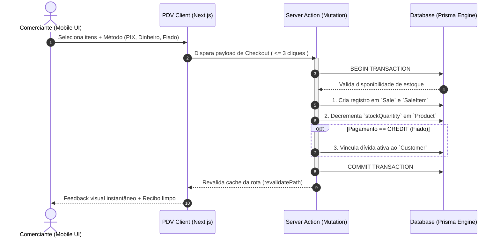

# ⚡ CAIXA ÁGIL // POS ENGINE
**Infraestrutura de Ponto de Venda (PDV), Controle de Estoque e Ledger de Crédito para o Comércio Popular.**

---

## 🧠 Visão Geral & Problema de Engenharia

No microcomércio brasileiro — especialmente em feiras livres e mercearias de bairro —, a operação financeira ainda roda sobre uma infraestrutura analógica frágil: **o caderno de papel e a calculadora física**. Do ponto de vista de sistemas, isso gera perda silenciosa de dados (*furos de caixa*), latência alta no atendimento em horários de pico, inadimplência por falta de rastreabilidade no crédito informal ("fiado") e zero observabilidade sobre a margem de lucro real.

O **Caixa Ágil** é uma aplicação web progressiva e *mobile-first* desenhada para substituir processos manuais por uma arquitetura digital resiliente, operando diretamente no navegador de smartphones de entrada sem exigir hardware dedicado de automação comercial.

---

## 🏗️ Arquitetura do Sistema & Fluxo Transacional

O coração do sistema foi projetado para garantir consistência de dados mesmo em operações rápidas de balcão. As mutações críticas utilizam **React Server Actions** acopladas a transações atômicas no banco de dados via **Prisma ORM**, garantindo que uma venda nunca seja registrada sem o respectivo abatimento de estoque e atualização do saldo devedor.

---

## ⚙️ Módulos Core

### 1. 🛒 Engine de PDV (Zero-Friction Checkout)
Projetado sob a regra dos **3 cliques**. A interface elimina digitação desnecessária durante o horário de pico: busca instantânea, adição ao carrinho com um toque (*tap-to-add*) e modal de fechamento direto com suporte nativo aos fluxos reais do comércio: `CASH`, `PIX`, `CARD` e `CREDIT` (Fiado).

### 2. 📒 Digitalização do "Caderninho" (Credit Ledger)
Transforma a venda a prazo informal em um razão contábil simplificado. Quando uma transação é marcada como `CREDIT`, o sistema exige o vínculo com uma entidade `Customer`, consolidando o histórico de débitos e permitindo liquidações parciais ou totais (*Dar Baixa*) com rastreabilidade completa.

### 3. 📦 Gestão Preditiva de Estoque
Controle de inventário sincronizado em tempo real com a frente de caixa. A cada checkout confirmado, os itens sofrem dedução imediata. O módulo conta com gatilhos visuais automáticos (*Warning Badges*) para produtos que entram na zona crítica de ruptura (estoque abaixo de 5 unidades).

### 4. 📊 Telemetria Diária (Dashboard)
Substitui o fechamento de caixa manual por agregação automática de dados no servidor, exibindo em tempo real:
* **Receita Bruta do Dia (R$)**
* **Lucro Líquido Estimado** (Baseado no spread entre *Preço de Venda* e *Custo de Aquisição*)
* **Volume Transacional Diário**

---

## 📱 Engenharia de UX: Extreme Mobile-First

Sistemas de ERP tradicionais falham no microcomércio por excesso de complexidade cognitiva. A interface do **Caixa Ágil** foi construída seguindo diretrizes estritas de ergonomia móvel e acessibilidade em campo:

* **Thumb-Zone Navigation:** Barra de navegação inferior fixa (*Bottom Bar*) posicionada estrategicamente para operação com apenas uma mão no balcão.
* **Alto Contraste & Touch Targets Amplos:** Componentes baseados em *shadcn/ui* e *Tailwind CSS* calibrados para leitura rápida em ambientes externos ou de baixa luminosidade (feiras e mercados).
* **Linguagem Ubíqua:** Eliminação total de jargões técnicos ou contábeis na camada de visualização, adotando o vocabulário natural do comerciante.

---

## 📈 Estudo de Caso & Impacto Real (Manaus, AM)

Esta arquitetura foi validada em campo como parte de uma intervenção tecnológica junto a microempreendedores locais no bairro da Compensa (Zona Oeste de Manaus/AM), confrontando o método tradicional em papel com a operação digitalizada:

| Indicador Operacional | Gestão Analógica (Caderno) | Caixa Ágil (POS Engine) | Impacto / Ganho |
| :--- | :---: | :---: | :---: |
| **Tempo de Fechamento de Caixa** | ~40 min / dia | **5 min / dia** | Redução de 87,5% no tempo operacional |
| **Rastreabilidade de "Fiados"** | Baixa (perda de anotações) | **100% Auditável** | Eliminação de perdas por esquecimento |
| **Visibilidade de Margem Real** | Inexistente | **Tempo Real** | Precificação corrigida por produto |
| **Curva de Aprendizado** | N/A | **Imediata** | 80% de retenção e uso diário contínuo |

---

  Arquitetado e desenvolvido por <b>Márcio Mateus Vieira Melo</b> · Engenharia de Software & Impacto Social

